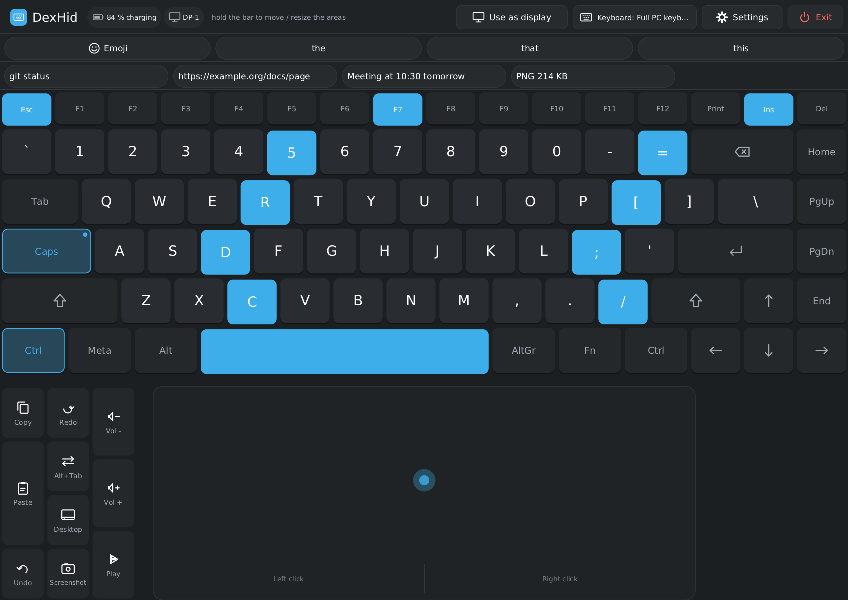
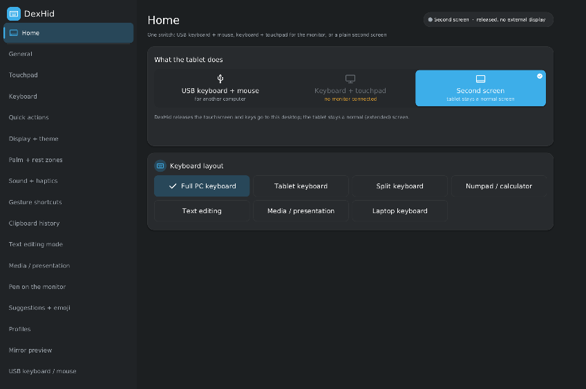
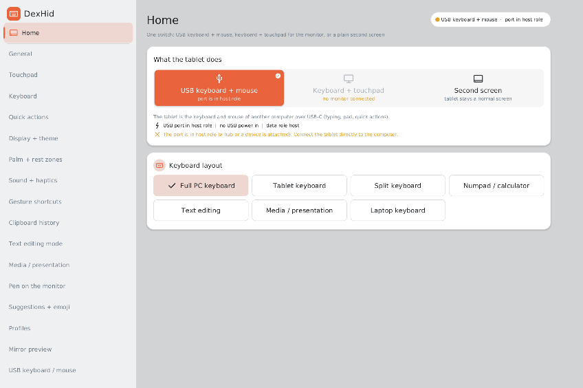
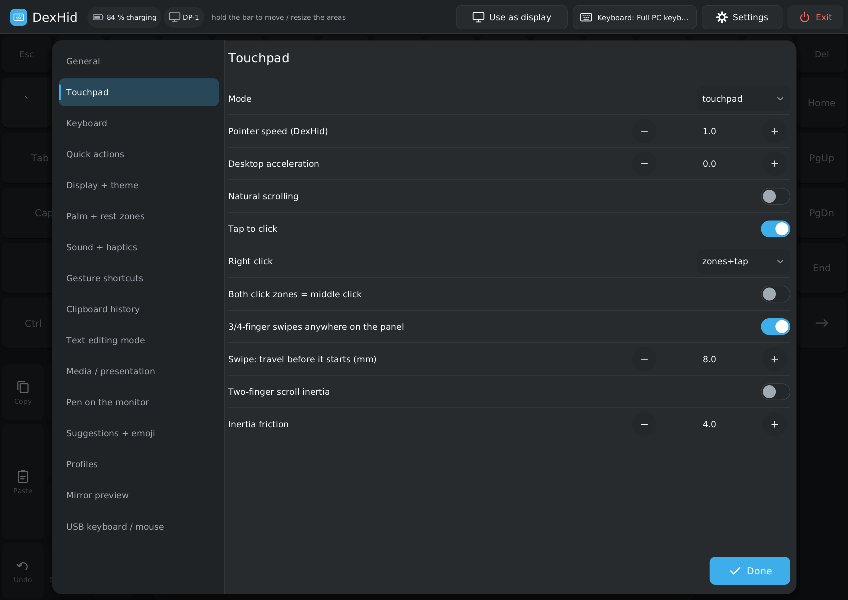
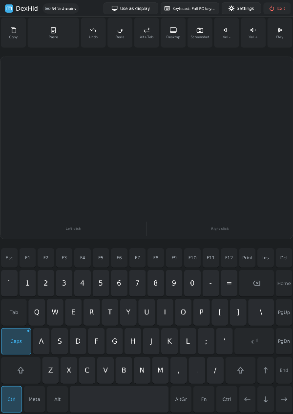

# DexHid

DexHid turns a Linux tablet's touchscreen into a keyboard and a touchpad. It has three modes:

| Mode | What the tablet does |
|---|---|
| **USB keyboard + mouse** | The tablet is a USB HID keyboard and mouse (with media and system keys) for the computer at the other end of the USB-C cable. Think of it as a KVM without the video. |
| **Keyboard + touchpad** | An external display is connected over USB-C. The tablet screen shows an on-screen keyboard and a touchpad that drive the desktop on that display. |
| **Second screen** | The tablet is a normal (extended) display again, and DexHid stays out of the way. |

DexHid is a small Rust daemon. It does not depend on a distribution or a compositor:

- In keyboard + touchpad mode it grabs the internal touchscreen and emits a virtual multitouch touchpad and a virtual
  keyboard through `uinput`. The desktop's own libinput settings, xkb layout and key repeat therefore apply.
- It draws its UI as a Wayland layer-shell overlay on the internal panel.
- It runs as a systemd user service with a session D-Bus API (`org.dexhid.DexHid1`) and a CLI.



## Screenshots

| | |
|---|---|
|  |  |
| App window, Home: the mode switch and the layout picker | Second screen mode; keyboard + touchpad is greyed out without a monitor |
|  |  |
| USB keyboard + mouse, light theme, with a live USB-role hint | Settings sheet over the pad (Touchpad page) |
|  |  |
| Edit mode: move and resize the keyboard, touchpad and quick-action areas | Portrait orientation |

The screenshots are renders of DexHid's own UI at the panel's aspect ratio. Clipboard and suggestion entries are demo
text.

## Features

### Mode switch and app window

- The app window (`dexhid window`, also in the app menu) has a **Home page with the 3-way mode switch** (USB keyboard
  + mouse / keyboard + touchpad / second screen) and the layout picker. Every setting is a page in the same window
  (`dexhid settings`). The window works without an external monitor and costs nothing while it is closed.
- App-menu actions: *USB keyboard + mouse*, *Keyboard + touchpad*, *Second screen*.
- Switching modes first releases every held key, button and touchpad contact, then changes the target.

### Keyboard + touchpad for an external display

- **Hotplug prompt:** when a monitor connects, a card offers *Use as pad*, *Keep as display*, *Always* or *Never*.
  The choice is remembered per monitor.
- **Touchpad:** libinput sees a real multitouch touchpad. Tap, two-finger tap, tap-and-drag, two-finger scrolling
  (optional inertia), 3- and 4-finger swipes, independent left / right click zones, and an optional middle-click
  chord all work. A mouse fallback mode is also available.
- **Layouts:** full PC (with an optional numpad and F-key row), tablet (letters plus a symbols page), split,
  numpad / calculator, text editing, media / presentation, laptop (square keys of one pitch, centred like a laptop
  deck), and touchpad only.
- **Move and resize** the keyboard, touchpad and quick-action regions in edit mode, with handles, snap guides and
  minimum sizes. Arrangements are saved per layout and orientation.
- **Keys:** keys send evdev codes, so the desktop's xkb layout applies. Legends come from libxkbcommon and follow the
  Shift, AltGr and Caps states. Also included:
  - sticky modifiers, an Fn layer, long-press alternates, and Caps / Num LEDs;
  - tap-on-release with a 150 ms stationary hold, and slide-off cancel;
  - a cancelled lone modifier does not open the launcher.
- **Gestures:** whole-screen 3- and 4-finger swipes work even over the keys and reach the desktop as touchpad
  gestures. Gesture shortcuts *(untested on hardware yet)* can be configured: back / forward, switch desktops, overview, show desktop, app switch,
  middle click, or any quick action.
- **Quick-action strip:** copy, paste, cut, undo, redo, select all, find and save; window, system and media
  actions; and your own key chords or commands.
- **Clipboard history** *(untested on hardware yet)*: a strip of the last 5-10 entries. It uses Klipper on KDE, otherwise wlr data-control.
- **Word suggestions and emoji panel** *(untested on hardware yet)*: suggestions come from a local word list plus your own words file. The emoji
  panel has five pages.
- **Text editing** *(untested on hardware yet)*: a select-mode key and a cursor joystick key.
- **Presentation** *(untested on hardware yet)*: a laser pointer (an absolute pointer mapped to the monitor) and a talk timer in the strip.
- **Pen on the monitor** *(untested on hardware yet)*: the pen works as a relative pointer, or as a drawing tablet with pressure and tilt.
- **Mirror preview** *(untested on hardware yet)*: a small live view of the monitor in a corner of the touchpad, through the xdg-desktop-portal
  ScreenCast API.
- **Profiles** *(untested on hardware yet)* per monitor or per app (`dexhid profile ...`), layered over the settings.
- **Look:** dark, light, AMOLED, or follow the desktop's colours. Sizes are set in millimetres. An optional
  half-resolution rendering mode is available.
- **Comfort:** the panel dims while in pad mode and is restored on exit. Rest zones, palm rejection and
  pen-proximity rejection are included. Battery and display info are shown in the strip.
- **Plasma panels follow the monitor** while in pad mode and are moved back afterwards (KDE only).

### USB keyboard + mouse for another computer

- A small root helper (`dexhid-hid.socket`) creates a configfs USB gadget with three functions: a boot keyboard, a
  boot mouse (with wheel and horizontal pan), and media / system controls. It passes the `/dev/hidgN` handles to the
  daemon.
- When the daemon stops or crashes, the helper releases every key and removes the gadget. The gadget's serial number
  is a fixed string (`dexhid-0001`), never the device's own serial.
- **Keyboard language of the target:** choose from 28 xkb layouts or variants, or follow the desktop's layout. This
  setting drives the legends, paste-as-typing and suggestions.
- **Live power line and USB role** in the strip and the settings. DexHid refuses to start while the port is in host
  role (a hub or dock is attached) or while another gadget is active. Stopping the other gadget is an option.
- **Power:** use a USB-C PD pass-through splitter (the tablet must stay the USB *device*) or the other computer's
  own power.

### Release paths

DexHid releases the touchscreen on any of these:

- the *Exit* button, `dexhid release`, or `dexhid toggle`;
- a **5-finger hold** anywhere (0.8 s);
- the emergency key chord **Volume Up + Volume Down** held for 2 s (configurable; read passively, never grabbed);
- unplugging the monitor, closing the lid, locking, suspending, losing the UI, SIGTERM, or a crash.

A separate guardian process owns the virtual keyboard. If the daemon dies or hangs, the guardian lifts any held key,
so no modifier stays stuck. The systemd watchdog restarts a hung daemon.

### CLI and D-Bus

```
dexhid mode [usb|pad|screen]      # show or switch the mode
dexhid window [PAGE|--close]      # open the app window (Home or a settings page)
dexhid settings [--json]          # open the settings, or print them as JSON for scripts
dexhid set KEY [VALUE]            # read or change one setting
dexhid toggle | release | resume | status | layout NAME | quick ID | hid-status
dexhid profile list | save NAME [monitor] [app=CLASS] | use NAME | auto | delete NAME
```

The D-Bus interface is `org.dexhid.DexHid1` on the session bus (`data/org.dexhid.DexHid1.xml`). It provides, among
others, `SetMode`, `OpenWindow`, `OpenSettings`, `CloseWindow`, `Toggle`, `Release`, `Resume`, `Status`,
`SetLayout`, `SetSetting`, `GetSettings`, `RunQuick` and `Profile`. A D-Bus activation
file starts the user service on demand.

## Efficiency

Measured on a OnePlus Pad 4 (Fedora 45, KDE Plasma 6.8, mainline Linux) with the 0.1.0 M4 build:

| Measurement | Value |
|---|---|
| Idle wake-ups, daemon + guardian | 0.02 per second |
| Wake-ups with the app window open, untouched | 0.00 per second |
| Wake-ups in keyboard + touchpad mode (touchscreen grabbed, untouched) | 0.5 per second |
| Key latency inside DexHid (touch-up to uinput key, median) | < 1 ms (0 ms) |
| Memory (PSS) | about 21 MB |

While idle there are no timers: the UI, guardian and HID helper sleep until an event arrives. Repaints are partial:
a Shift press redraws only the keys whose legend changes, and a settings tap redraws only its row.

## Install

### Fedora (RPM)

The spec is `packaging/fedora/dexhid.spec`. It builds offline from a source tarball and a `cargo vendor` tarball:

```bash
git clone https://github.com/mzakamin-hub/DexHid && cd DexHid
mkdir -p ~/rpmbuild/SOURCES
git archive --prefix=DexHid-0.1.0/ -o ~/rpmbuild/SOURCES/dexhid-0.1.0.tar.gz HEAD
cargo vendor --locked vendor >/dev/null && tar -czf ~/rpmbuild/SOURCES/dexhid-0.1.0-vendor.tar.gz vendor && rm -rf vendor
rpmbuild -ba packaging/fedora/dexhid.spec     # or mock: --buildsrpm, then --rebuild
sudo dnf install ~/rpmbuild/RPMS/*/dexhid-0.1.0-*.rpm
```

Then enable what you need:

```bash
systemctl --user enable --now dexhid.service       # the daemon (keyboard + touchpad, app window)
sudo systemctl enable --now dexhid-hid.socket      # only for the USB keyboard + mouse mode
```

### From source (any distribution)

```bash
cargo build --release --locked
```

Install `target/release/dexhid` to `/usr/bin/dexhid`. Then install the files from `data/` to the paths that the
spec uses:

| File | Destination | Purpose |
|---|---|---|
| `dexhid.service` | `/usr/lib/systemd/user/` | The daemon, a systemd user service (watchdog, guardian, brightness restore) |
| `dexhid-hid.socket`, `dexhid-hid.service` | `/usr/lib/systemd/system/` | The root helper for the USB HID gadget, socket-activated. It exits when idle |
| `70-dexhid.rules` | `/usr/lib/udev/rules.d/` | Gives the seat user access to `/dev/uinput`, the internal touchscreen, the pen and the volume keys |
| `org.dexhid.DexHid1.xml`, `org.dexhid.DexHid1.service` | `/usr/share/dbus-1/interfaces/`, `/usr/share/dbus-1/services/` | The D-Bus interface and its activation file |
| `org.dexhid.DexHid*.desktop`, `dexhid.desktop` | `/usr/share/applications/`, `/etc/xdg/autostart/` | The app-menu entries and autostart |
| `layouts/*.toml`, `devices/*.toml`, `config.example.toml` | `/usr/share/dexhid/` | The keyboard layouts, the device presets and the example configuration |

To build it you only need Rust (stable); there are no C library headers to install. At run time it loads
libxkbcommon (without it the key legends stay US). The mirror preview also needs GStreamer with
`pipewire-gstreamer`.

## Configuration

Most options are in the app window. The file configuration is merged in this order:

1. the built-in defaults;
2. the device preset `/usr/share/dexhid/devices/*.toml` that matches the device-tree compatible;
3. `/etc/dexhid/config.toml`;
4. `~/.config/dexhid/config.toml`.

`data/config.example.toml` documents every key. A device preset names the touchscreen, the pen, the internal output,
the panel size and the external connectors. To port DexHid to another tablet, add a preset and the matching udev
lines in `70-dexhid.rules`. Custom layouts go to `~/.local/share/dexhid/layouts/`, and extra suggestion words to
`~/.config/dexhid/words.txt`.

## Uninstall

```bash
systemctl --user disable --now dexhid.service
sudo systemctl disable --now dexhid-hid.socket
sudo dnf remove dexhid            # or delete the files listed above
rm -rf ~/.config/dexhid ~/.local/state/dexhid ~/.local/share/dexhid   # optional: settings, profiles, layouts
```

## Tested platforms and limits

- **Tested on:** OnePlus Pad 4 with mainline Linux, Fedora 45, KDE Plasma 6.8 (KWin, Wayland). For USB HID, a Windows
  PC was the host: it shows a keyboard, an HID-compliant mouse, a consumer-control device and a system controller.
- **Compositor:** a Wayland compositor with `wlr-layer-shell` is needed for the overlay. Some extras are KDE only:
  Plasma panels follow the monitor, live keyboard-layout tracking, Klipper clipboard history, the laser's mapping to
  the monitor, and the desktop look.
- **USB HID** needs a USB-C port that can work in device (peripheral) role with configfs gadget support. It cannot
  work through a hub or dock, because those make the tablet the USB host.
- **Bluetooth HID was removed on purpose.** It conflicted with the BlueZ input plugin, which Bluetooth keyboard covers
  need.
- **Mirror preview** needs `gstreamer1-plugins-base` and `pipewire-gstreamer`, and asks once for screen-cast
  permission.
- **Emoji** glyphs depend on the installed fonts (Noto Emoji or Symbola); a missing glyph shows its code point.
- Only the OnePlus Pad 4 has a device preset so far.

## Credits

- **Inspiration:** the idea of using the tablet as a keyboard and touchpad for an external display comes from the
  input deck of [Denial](https://github.com/denialwm/denial) ([DenialWM](https://github.com/denialwm)) by Doctor
  Logix. DexHid also uses the deck's behaviour numbers: the tap / hold timing, the click zones and the swipe
  thresholds. DexHid is written from scratch and contains no Denial code.
- **`third_party/blocking`** is [smol-rs/blocking](https://github.com/smol-rs/blocking) 1.7.0 (Apache-2.0 OR MIT;
  its `LICENSE-APACHE` and `LICENSE-MIT` are kept). It carries one change, described in
  `third_party/blocking/DEXHID-PATCH.md`, that lets idle pool threads exit so the idle daemon does not wake up.
- The other Rust dependencies come from crates.io under their own licences. The RPM build lists them in
  `LICENSE.dependencies`.

## Licence

DexHid is free software. You can redistribute it and/or modify it under the terms of the GNU General Public License
as published by the Free Software Foundation, either version 3 of the License or (at your option) any later version
(`GPL-3.0-or-later`). The full text is in [`LICENSE`](LICENSE). Code in `third_party/` keeps its own licence.
