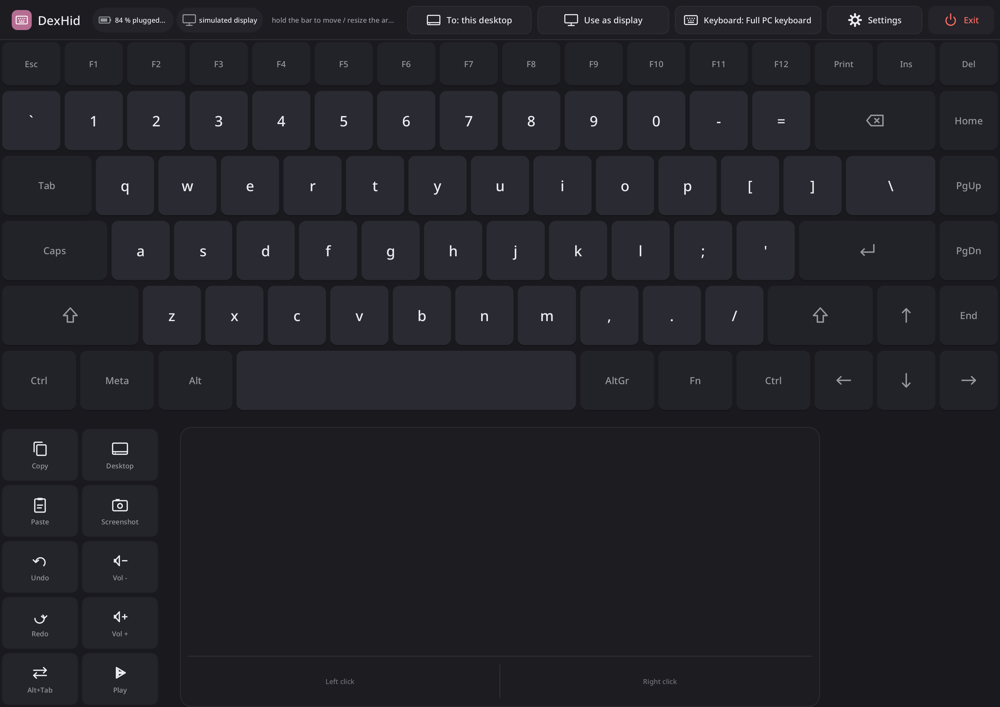
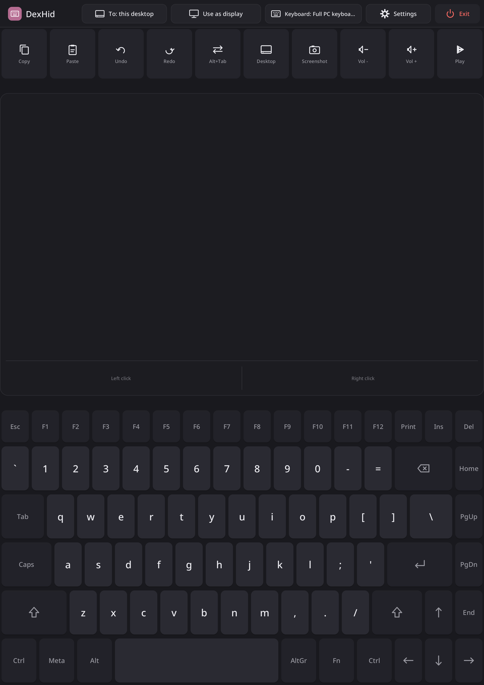
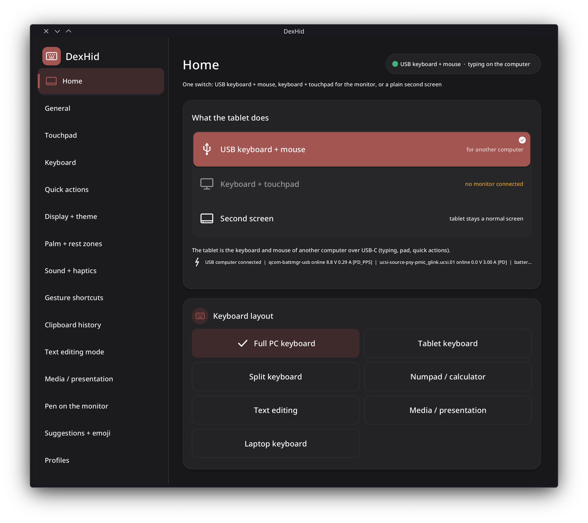
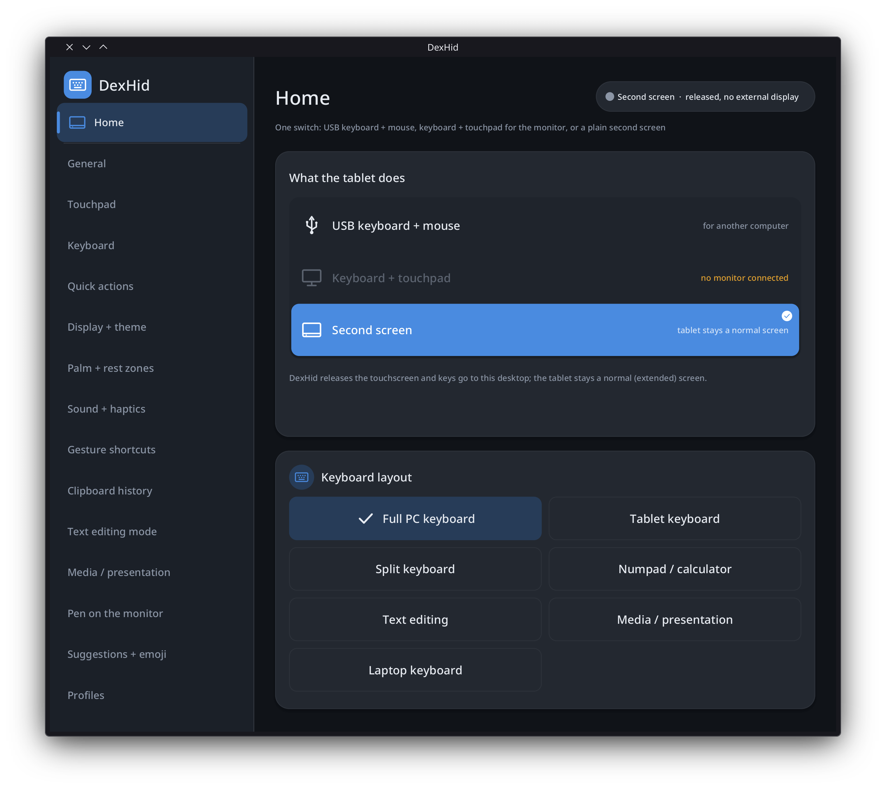
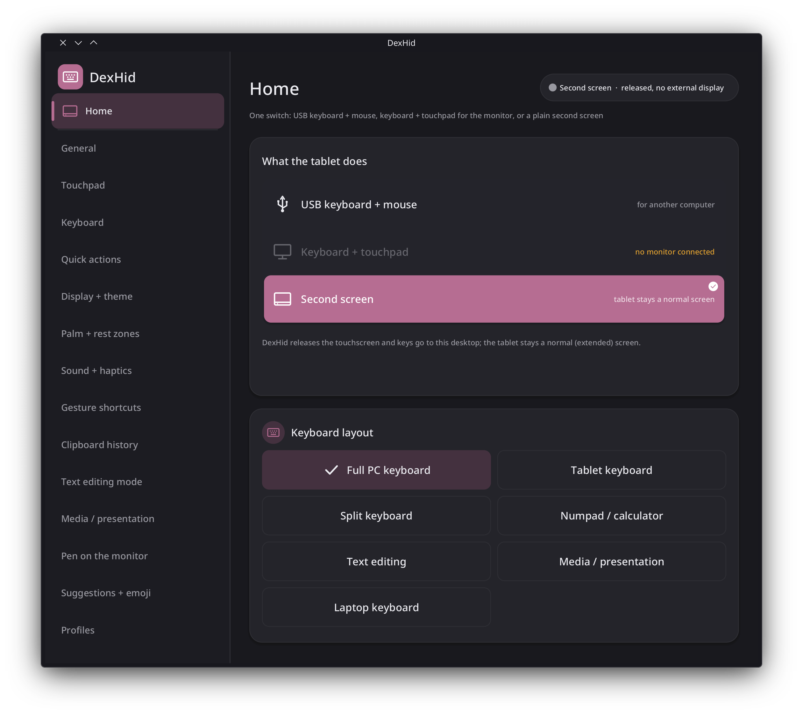
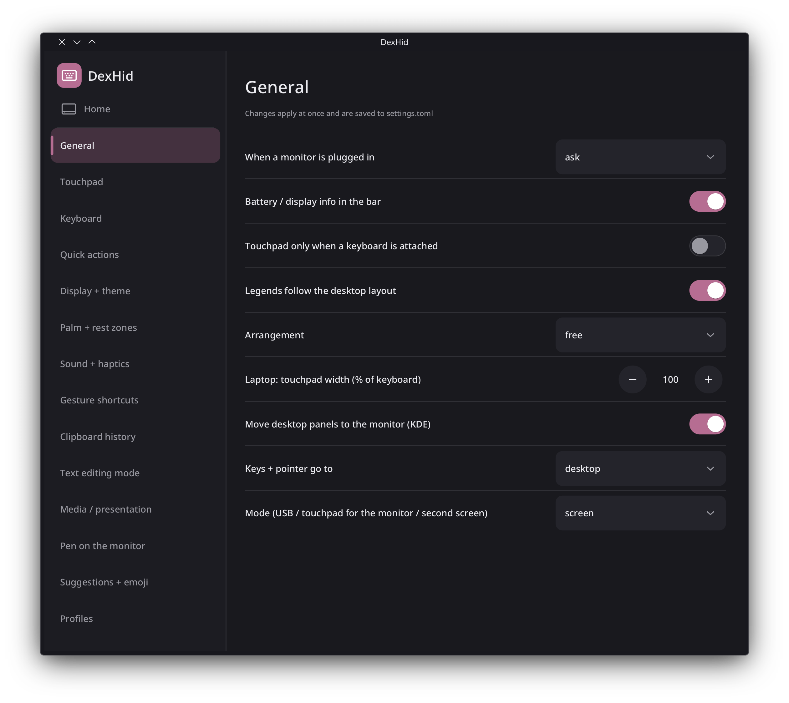
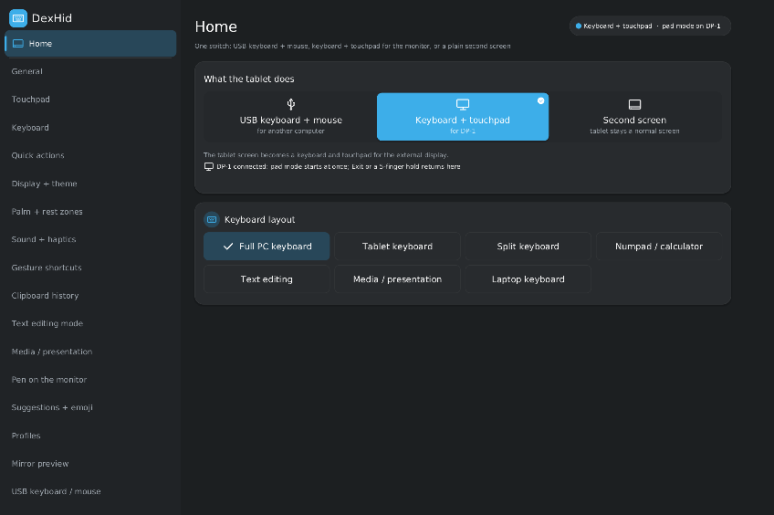
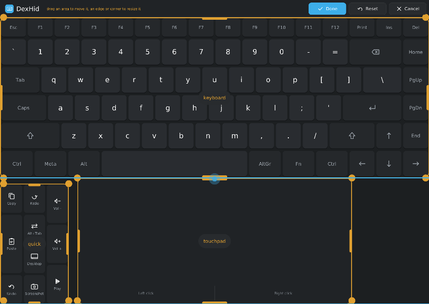

# DexHid

**Plug your Linux tablet into a monitor and the tablet becomes that monitor's keyboard and mouse.**

That is DexHid's main purpose. Connect an external display to the tablet's USB-C port (DisplayPort alt mode, directly
or through a USB-C dock). The desktop moves to the big screen, and the tablet's own touchscreen turns into a full
keyboard and a multitouch touchpad that drive it. You get a desktop PC set-up — monitor in front, tablet as keyboard
and touchpad — with no extra keyboard or mouse to carry, similar in spirit to Samsung DeX's "phone as touchpad".

The same app can also make the tablet a USB keyboard and mouse for another computer, or simply step aside and leave
the tablet as a normal second screen. DexHid has three modes:

| Mode | What the tablet does |
|---|---|
| **USB keyboard + mouse** | The tablet is a USB HID keyboard and mouse (with media and system keys) for the computer at the other end of the USB-C cable. Think of it as a KVM without the video. |
| **Keyboard + touchpad** | An external display is connected over USB-C. The tablet screen shows an on-screen keyboard and a touchpad that drive the desktop on that display. |
| **Second screen** | The tablet is a normal (extended) display again, and DexHid stays out of the way. |

DexHid is a small Rust daemon. It does not depend on a distribution or a compositor:

- In keyboard + touchpad mode it grabs the internal touchscreen and emits a virtual multitouch touchpad and a virtual
  keyboard through `uinput`. The desktop's own libinput settings, xkb layout and key repeat therefore apply.
- It draws its UI as a Wayland layer-shell overlay on the internal panel.
- It runs as a systemd user service with a session D-Bus API (`org.dexhid.DexHid1`) and a CLI.



### How it works, in short

1. Plug a monitor into the tablet's USB-C port. DexHid notices the new output (`DP-*`) and asks once: *Use as pad*,
   *Keep as display*, *Always* or *Never*.
2. In pad mode the desktop goes to the monitor. The tablet screen shows the keyboard, the touchpad and a quick-action
   strip. Everything you type or swipe goes to the monitor's desktop as if a real keyboard and touchpad were plugged
   in (they are virtual `uinput` devices, so your desktop's layout, libinput and gesture settings all apply).
3. Unplug the monitor, tap *Exit*, or hold five fingers on the screen, and the tablet is a normal tablet again.

## Screenshots

All screenshots below are real captures from a OnePlus Pad 4 (Fedora 45, KDE Plasma 6.8), except the two marked
*render*.

| | |
|---|---|
|  |  |
| Pad mode in portrait: quick actions, touchpad, full PC keyboard | App window, Home: USB keyboard + mouse for another computer, with the live USB-role and power line |
|  |  |
| Home: second screen; *Keyboard + touchpad* waits for a monitor | Settings: the Touchpad page |
|  |  |
| Settings: the General page (monitor hotplug behaviour, arrangement, mode) | *Render:* Home with *Keyboard + touchpad* active (needs a monitor) |
|  | |
| *Render:* edit mode, move and resize the keyboard, touchpad and quick-action areas | |

The pad captures were taken with a simulated monitor (`dexhid daemon --debug --simulate-connect`), which is why the
strip says *simulated display*.

## Features

### Mode switch and app window

- The app window (`dexhid window`, also in the app menu) has a **Home page with the 3-way mode switch** (USB keyboard
  + mouse / keyboard + touchpad / second screen) and the layout picker. Every setting is a page in the same window
  (`dexhid settings`). The window works without an external monitor and costs nothing while it is closed.
- App-menu actions: *USB keyboard + mouse*, *Keyboard + touchpad*, *Second screen*.
- Switching modes first releases every held key, button and touchpad contact, then changes the target.

### Keyboard + touchpad for an external display

- **Hotplug prompt:** when a monitor connects, a card offers *Use as pad*, *Keep as display*, *Always* or *Never*.
  The choice is remembered per monitor.
- **Touchpad:** libinput sees a real multitouch touchpad. Tap, two-finger tap, tap-and-drag, two-finger scrolling
  (optional inertia), 3- and 4-finger swipes, independent left / right click zones, and an optional middle-click
  chord all work. A mouse fallback mode is also available.
- **Layouts:** full PC (with an optional numpad and F-key row), tablet (letters plus a symbols page), split,
  numpad / calculator, text editing, media / presentation, laptop (square keys of one pitch, centred like a laptop
  deck), and touchpad only.
- **Move and resize** the keyboard, touchpad and quick-action regions in edit mode, with handles, snap guides and
  minimum sizes. Arrangements are saved per layout and orientation.
- **Keys:** keys send evdev codes, so the desktop's xkb layout applies. Legends come from libxkbcommon and follow the
  Shift, AltGr and Caps states. Also included:
  - sticky modifiers, an Fn layer, long-press alternates, and Caps / Num LEDs;
  - tap-on-release with a 150 ms stationary hold, and slide-off cancel;
  - a cancelled lone modifier does not open the launcher.
- **Gestures:** whole-screen 3- and 4-finger swipes work even over the keys and reach the desktop as touchpad
  gestures. Gesture shortcuts *(untested on hardware yet)* can be configured: back / forward, switch desktops, overview, show desktop, app switch,
  middle click, or any quick action.
- **Quick-action strip:** copy, paste, cut, undo, redo, select all, find and save; window, system and media
  actions; and your own key chords or commands.
- **Clipboard history** *(untested on hardware yet)*: a strip of the last 5-10 entries. It uses Klipper on KDE, otherwise wlr data-control.
- **Word suggestions and emoji panel** *(untested on hardware yet)*: suggestions come from a local word list plus your own words file. The emoji
  panel has five pages.
- **Text editing** *(untested on hardware yet)*: a select-mode key and a cursor joystick key.
- **Presentation** *(untested on hardware yet)*: a laser pointer (an absolute pointer mapped to the monitor) and a talk timer in the strip.
- **Pen on the monitor** *(untested on hardware yet)*: the pen works as a relative pointer, or as a drawing tablet with pressure and tilt.
- **Mirror preview** *(untested on hardware yet)*: a small live view of the monitor in a corner of the touchpad, through the xdg-desktop-portal
  ScreenCast API.
- **Profiles** *(untested on hardware yet)* per monitor or per app (`dexhid profile ...`), layered over the settings.
- **Look:** dark, light, AMOLED, or follow the desktop's colours. Sizes are set in millimetres. An optional
  half-resolution rendering mode is available.
- **Comfort:** the panel dims while in pad mode and is restored on exit. Rest zones, palm rejection and
  pen-proximity rejection are included. Battery and display info are shown in the strip.
- **Plasma panels follow the monitor** while in pad mode and are moved back afterwards (KDE only).

### USB keyboard + mouse for another computer

- A small root helper (`dexhid-hid.socket`) creates a configfs USB gadget with three functions: a boot keyboard, a
  boot mouse (with wheel and horizontal pan), and media / system controls. It passes the `/dev/hidgN` handles to the
  daemon.
- When the daemon stops or crashes, the helper releases every key and removes the gadget. The gadget's serial number
  is a fixed string (`dexhid-0001`), never the device's own serial.
- **Keyboard language of the target:** choose from 28 xkb layouts or variants, or follow the desktop's layout. This
  setting drives the legends, paste-as-typing and suggestions.
- **Live power line and USB role** in the strip and the settings. DexHid refuses to start while the port is in host
  role (a hub or dock is attached) or while another gadget is active. Stopping the other gadget is an option.
- **Power:** use a USB-C PD pass-through splitter (the tablet must stay the USB *device*) or the other computer's
  own power.

### Release paths

DexHid releases the touchscreen on any of these:

- the *Exit* button, `dexhid release`, or `dexhid toggle`;
- a **5-finger hold** anywhere (0.8 s);
- the emergency key chord **Volume Up + Volume Down** held for 2 s (configurable; read passively, never grabbed);
- unplugging the monitor, closing the lid, locking, suspending, losing the UI, SIGTERM, or a crash.

A separate guardian process owns the virtual keyboard. If the daemon dies or hangs, the guardian lifts any held key,
so no modifier stays stuck. The systemd watchdog restarts a hung daemon.

### CLI and D-Bus

```
dexhid mode [usb|pad|screen]      # show or switch the mode
dexhid window [PAGE|--close]      # open the app window (Home or a settings page)
dexhid settings [--json]          # open the settings, or print them as JSON for scripts
dexhid set KEY [VALUE]            # read or change one setting
dexhid toggle | release | resume | status | layout NAME | quick ID | hid-status
dexhid profile list | save NAME [monitor] [app=CLASS] | use NAME | auto | delete NAME
```

The D-Bus interface is `org.dexhid.DexHid1` on the session bus (`data/org.dexhid.DexHid1.xml`). It provides, among
others, `SetMode`, `OpenWindow`, `OpenSettings`, `CloseWindow`, `Toggle`, `Release`, `Resume`, `Status`,
`SetLayout`, `SetSetting`, `GetSettings`, `RunQuick` and `Profile`. A D-Bus activation
file starts the user service on demand.

## Efficiency

Measured on a OnePlus Pad 4 (Fedora 45, KDE Plasma 6.8, mainline Linux) with the 0.1.0 M4 build:

| Measurement | Value |
|---|---|
| Idle wake-ups, daemon + guardian | 0.02 per second |
| Wake-ups with the app window open, untouched | 0.00 per second |
| Wake-ups in keyboard + touchpad mode (touchscreen grabbed, untouched) | 0.5 per second |
| Key latency inside DexHid (touch-up to uinput key, median) | < 1 ms (0 ms) |
| Memory (PSS) | about 21 MB |

While idle there are no timers: the UI, guardian and HID helper sleep until an event arrives. Repaints are partial:
a Shift press redraws only the keys whose legend changes, and a settings tap redraws only its row.

## Requirements

### Hardware

| Need | For | Notes |
|---|---|---|
| A touchscreen with multitouch (evdev MT protocol B) | all modes | The internal panel; at least 5 contacts for the 5-finger release |
| USB-C with **DisplayPort alt mode** (or a dock that outputs DP / HDMI) | keyboard + touchpad mode | The external display must show up as a DRM connector, e.g. `DP-1` |
| USB-C port that can run in **device (peripheral) role** | USB keyboard + mouse mode only | A dual-role controller (e.g. dwc3) with a role switch; not through a hub or dock |
| Volume keys (or any two buttons) | emergency release chord | Optional; read passively, never grabbed |
| An active pen | pen features | Optional |

### Kernel

| Option | For |
|---|---|
| `CONFIG_INPUT_UINPUT` | the virtual keyboard and touchpad (always needed) |
| `CONFIG_INPUT_EVDEV` | reading the touchscreen, pen and keys |
| `CONFIG_DRM` with the SoC's DisplayPort / USB-C alt-mode driver, `CONFIG_TYPEC` | detecting the external monitor |
| `CONFIG_USB_CONFIGFS`, `CONFIG_USB_CONFIGFS_F_HID`, `CONFIG_USB_LIBCOMPOSITE`, a UDC driver in OTG / peripheral mode, `CONFIG_USB_ROLE_SWITCH` | USB keyboard + mouse mode only |

### Desktop and system

| Need | Required? | Why |
|---|---|---|
| A **Wayland** compositor with `wlr-layer-shell` (`zwlr_layer_shell_v1`) | required | The pad overlay is a layer-shell surface on the internal panel. KWin, Sway, Hyprland, Wayfire, labwc and niri have it; GNOME's Mutter does not |
| `xdg-shell`, `wl_shm`, `wl_seat`, `wl_output` | required | The app window and rendering (software, no GPU needed) |
| **systemd** (user services, logind) | required | The daemon runs as a user service with a watchdog; lock / suspend events trigger the release |
| A **session D-Bus** | required | The API (`org.dexhid.DexHid1`), the CLI and the app-menu entries talk over it |
| **udev** with `uaccess` | required | Gives the logged-in user access to `/dev/uinput`, the touchscreen, pen and keys (`data/70-dexhid.rules`) |
| `libxkbcommon` | recommended | Key legends follow the desktop's keyboard layout; without it they stay US |
| `wlr-data-control` or KDE Klipper | optional | Clipboard history |
| GStreamer (`gstreamer1-plugins-base`) + `pipewire-gstreamer` + xdg-desktop-portal | optional | Mirror preview of the monitor |
| Noto Emoji or Symbola fonts | optional | Emoji panel glyphs |
| `libinput-utils` | optional | Debugging the virtual touchpad (`libinput debug-events`) |
| KDE Plasma 6 | optional | Extras: panels follow the monitor, live layout tracking, desktop colours |

## Dependencies

### Build

- **Rust** (stable toolchain, edition 2021) and Cargo. No C headers or `pkg-config` libraries are needed: Wayland,
  D-Bus and uinput are spoken directly, and libxkbcommon is loaded at run time.
- Fedora RPM builds also use `cargo-rpm-macros`, `systemd-rpm-macros` and `desktop-file-utils`.

### Rust crates

| Crate | Version | Used for |
|---|---|---|
| `wayland-client` | 0.31 | Wayland connection, surfaces, input |
| `wayland-protocols` | 0.32 | `xdg-shell` and other standard protocols |
| `wayland-protocols-wlr` | 0.3 | `wlr-layer-shell` (overlay), `wlr-data-control` (clipboard) |
| `zbus` | 5 (`blocking-api`, `async-io`) | The session D-Bus API, logind and portal calls |
| `ab_glyph` | 0.2 | Text rendering into shared-memory buffers |
| `serde`, `serde_json`, `toml` | 1, 1, 0.9 | Settings, layouts, device presets, JSON status |
| `libc` | 0.2 | uinput / evdev ioctls, configfs, signals |
| `blocking` | 1.7.0, vendored in `third_party/` | One patch so idle pool threads exit (no idle wake-ups) |

`Cargo.lock` pins every transitive crate; the RPM build vendors them and lists their licences in
`LICENSE.dependencies`.

### Run time (Fedora package names)

`libxkbcommon` (required by the RPM); recommended: `libinput-utils`, `gstreamer1-plugins-base`, `pipewire-gstreamer`.

## Porting DexHid to another device

DexHid has no device-specific code: everything about a device lives in one preset file and a few udev lines. To
bring it to another tablet, phone or laptop:

1. **Check the requirements above.** Most important: a Wayland compositor with `wlr-layer-shell`, `uinput`, and an
   external display that appears as a DRM connector when plugged in (check with `ls /sys/class/drm/` or
   `kscreen-doctor -o` / `wlr-randr` before and after plugging the monitor in).
2. **Find your input devices:**
   ```bash
   sudo libinput list-devices        # or: cat /proc/bus/input/devices
   ```
   Note the exact names of the internal touchscreen, the pen (if any) and the device(s) that carry the volume keys
   (often `gpio-keys` and a PMIC "resin" device on Qualcomm).
3. **Find the internal output and the panel size:** the internal connector name (e.g. `DSI-1`, `eDP-1`) from
   `kscreen-doctor -o` / `wlr-randr`, and the visible panel size in millimetres (from the spec sheet, or
   `/sys/class/drm/*/edid` / the device tree `width-mm` / `height-mm`).
4. **Find the match key:** the device-tree compatible (`tr '\0' '\n' < /proc/device-tree/compatible`, first entry).
   Presets match only device-tree compatibles. On ACPI machines (x86 tablets and laptops), put the same keys into
   `/etc/dexhid/config.toml` instead of a preset. `internal_output = "auto"` picks the first DSI / eDP / LVDS
   output, and the defaults already treat `DP-*`, `HDMI-*` and `USB-C-*` as external.
5. **Write a preset** `data/devices/<vendor>-<device>.toml`, modelled on the OnePlus Pad 4 one:
   ```toml
   # SPDX-License-Identifier: GPL-3.0-or-later
   match_compatible = ["oneplus,iceland"]   # your device-tree compatible
   touchscreen = "NVTCapacitiveTouchScreen"  # exact evdev name of the internal touchscreen
   pen = "NVTCapacitivePen"                  # exact evdev name of the pen, or leave out
   internal_output = "DSI-1"                 # the tablet's own panel ("auto" = first DSI / eDP / LVDS output)
   size_mm = [274.0, 193.0]                  # panel width, height in mm, native orientation (sets key sizes)
   external_connectors = ["DP-*"]            # globs of connectors that count as "a monitor was plugged in"
   ```
   Any key from `data/config.example.toml` can also go into a preset (e.g. `release_chord` if your device has
   different buttons):
   ```toml
   release_chord = ["KEY_VOLUMEUP", "KEY_VOLUMEDOWN"]
   ```
6. **Add udev lines** to `data/70-dexhid.rules` (copy the existing ones and change the `ATTRS{name}` values): mark the
   touchscreen with `DEXHID_INTERNAL`, the pen with `DEXHID_PEN` and the key devices with `DEXHID_CHORD`, so the seat
   user gets access through `uaccess`. Then reload: `sudo udevadm control --reload && sudo udevadm trigger`.
7. **USB keyboard + mouse mode (optional):** make sure the USB-C controller can switch to device role
   (`cat /sys/class/usb_role/*/role`) and that `/sys/kernel/config/usb_gadget` exists. `dexhid hid-status` shows the
   role, the UDC and the power line, and says why the mode would refuse to start.
8. **Test without a monitor:** run `dexhid daemon --debug --simulate-connect`, then `dexhid mode pad`. The pad comes up
   as if a monitor were connected; check the touch mapping in both orientations, the 5-finger release and the
   emergency chord. `libinput debug-events` shows what the virtual touchpad and keyboard emit.
9. **Send the preset and udev lines upstream** as a pull request, with the device name and what you tested.

On a desktop without `wlr-layer-shell` (GNOME), the daemon, the CLI and the USB HID mode still work, but the on-screen
pad cannot be drawn.

## Install

### Fedora (RPM)

The spec is `packaging/fedora/dexhid.spec`. It builds offline from a source tarball and a `cargo vendor` tarball:

```bash
git clone https://github.com/mzakamin-hub/DexHid && cd DexHid
mkdir -p ~/rpmbuild/SOURCES
git archive --prefix=DexHid-0.1.0/ -o ~/rpmbuild/SOURCES/dexhid-0.1.0.tar.gz HEAD
cargo vendor --locked vendor >/dev/null && tar -czf ~/rpmbuild/SOURCES/dexhid-0.1.0-vendor.tar.gz vendor && rm -rf vendor
rpmbuild -ba packaging/fedora/dexhid.spec     # or mock: --buildsrpm, then --rebuild
sudo dnf install ~/rpmbuild/RPMS/*/dexhid-0.1.0-*.rpm
```

Then enable what you need:

```bash
systemctl --user enable --now dexhid.service       # the daemon (keyboard + touchpad, app window)
sudo systemctl enable --now dexhid-hid.socket      # only for the USB keyboard + mouse mode
```

### From source (any distribution)

```bash
cargo build --release --locked
```

Install `target/release/dexhid` to `/usr/bin/dexhid`. Then install the files from `data/` to the paths that the
spec uses:

| File | Destination | Purpose |
|---|---|---|
| `dexhid.service` | `/usr/lib/systemd/user/` | The daemon, a systemd user service (watchdog, guardian, brightness restore) |
| `dexhid-hid.socket`, `dexhid-hid.service` | `/usr/lib/systemd/system/` | The root helper for the USB HID gadget, socket-activated. It exits when idle |
| `70-dexhid.rules` | `/usr/lib/udev/rules.d/` | Gives the seat user access to `/dev/uinput`, the internal touchscreen, the pen and the volume keys |
| `org.dexhid.DexHid1.xml`, `org.dexhid.DexHid1.service` | `/usr/share/dbus-1/interfaces/`, `/usr/share/dbus-1/services/` | The D-Bus interface and its activation file |
| `org.dexhid.DexHid*.desktop`, `dexhid.desktop` | `/usr/share/applications/`, `/etc/xdg/autostart/` | The app-menu entries and autostart |
| `layouts/*.toml`, `devices/*.toml`, `config.example.toml` | `/usr/share/dexhid/` | The keyboard layouts, the device presets and the example configuration |

See [Requirements](#requirements) and [Dependencies](#dependencies) for what the build and the run time need.

## Configuration

Most options are in the app window. The file configuration is merged in this order:

1. the built-in defaults;
2. the device preset `/usr/share/dexhid/devices/*.toml` that matches the device-tree compatible;
3. `/etc/dexhid/config.toml`;
4. `~/.config/dexhid/config.toml`.

`data/config.example.toml` documents every key. A device preset names the touchscreen, the pen, the internal output,
the panel size and the external connectors; see [Porting DexHid to another device](#porting-dexhid-to-another-device).
Custom layouts go to `~/.local/share/dexhid/layouts/`, and extra suggestion words to
`~/.config/dexhid/words.txt`.

## Uninstall

```bash
systemctl --user disable --now dexhid.service
sudo systemctl disable --now dexhid-hid.socket
sudo dnf remove dexhid            # or delete the files listed above
rm -rf ~/.config/dexhid ~/.local/state/dexhid ~/.local/share/dexhid   # optional: settings, profiles, layouts
```

## Tested platforms and limits

- **Tested on:** OnePlus Pad 4 with mainline Linux, Fedora 45, KDE Plasma 6.8 (KWin, Wayland). For USB HID, a Windows
  PC was the host: it shows a keyboard, an HID-compliant mouse, a consumer-control device and a system controller.
- **Compositor:** a Wayland compositor with `wlr-layer-shell` is needed for the overlay. Some extras are KDE only:
  Plasma panels follow the monitor, live keyboard-layout tracking, Klipper clipboard history, the laser's mapping to
  the monitor, and the desktop look.
- **USB HID** needs a USB-C port that can work in device (peripheral) role with configfs gadget support. It cannot
  work through a hub or dock, because those make the tablet the USB host.
- **Bluetooth HID was removed on purpose.** It conflicted with the BlueZ input plugin, which Bluetooth keyboard covers
  need.
- **Mirror preview** needs `gstreamer1-plugins-base` and `pipewire-gstreamer`, and asks once for screen-cast
  permission.
- **Emoji** glyphs depend on the installed fonts (Noto Emoji or Symbola); a missing glyph shows its code point.
- Only the OnePlus Pad 4 has a device preset so far.

## Credits

- **Inspiration:** the idea of using the tablet as a keyboard and touchpad for an external display comes from the
  input deck of [Denial](https://github.com/denialwm/denial) ([DenialWM](https://github.com/denialwm)) by Doctor
  Logix. DexHid also uses the deck's behaviour numbers: the tap / hold timing, the click zones and the swipe
  thresholds. DexHid is written from scratch and contains no Denial code.
- **`third_party/blocking`** is [smol-rs/blocking](https://github.com/smol-rs/blocking) 1.7.0 (Apache-2.0 OR MIT;
  its `LICENSE-APACHE` and `LICENSE-MIT` are kept). It carries one change, described in
  `third_party/blocking/DEXHID-PATCH.md`, that lets idle pool threads exit so the idle daemon does not wake up.
- The other Rust dependencies come from crates.io under their own licences. The RPM build lists them in
  `LICENSE.dependencies`.

## Licence

DexHid is free software. You can redistribute it and/or modify it under the terms of the GNU General Public License
as published by the Free Software Foundation, either version 3 of the License or (at your option) any later version
(`GPL-3.0-or-later`). The full text is in [`LICENSE`](LICENSE). Code in `third_party/` keeps its own licence.
